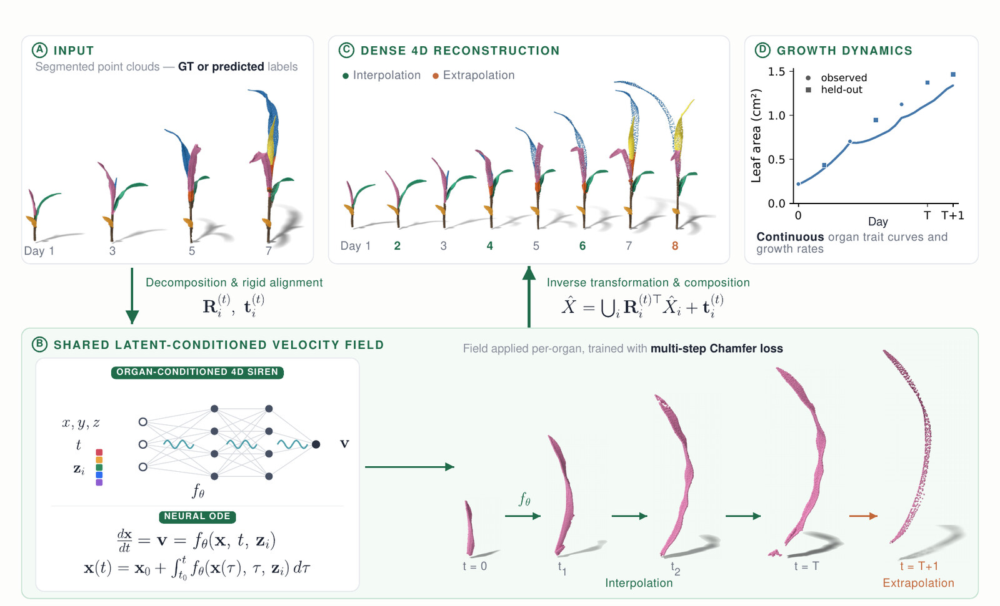

# GrowFields: Compositional 4D Neural Fields for Topology-Changing Plant Growth

**ECCV 2026**

[Joaquin Gajardo](https://joaquin-gajardo.github.io/)<sup>1</sup>,
[Michele Volpi](https://www.datascience.ch/people/michele-volpi)<sup>2</sup>,
[Marko Mihajlovic](https://markomih.github.io/)<sup>1</sup>,
[Siyu Tang](https://vlg.inf.ethz.ch/team/Prof-Dr-Siyu-Tang.html)<sup>1</sup>,
[Lukas Roth](https://www.landw.uni-halle.de/professuren_arbeitsgruppen/31_precisionphenotyping/lukas_roth/)<sup>1,3</sup>,
[Sergey Prokudin](https://sergeyprokudin.github.io/)<sup>1</sup>

<sup>1</sup> ETH Zürich, <sup>2</sup> Swiss Data Science Center, <sup>3</sup> Martin-Luther-Universität Halle-Wittenberg

[[Paper](https://link.springer.com/chapter/10.1007/978-3-032-37393-9_22)] [[arXiv](https://arxiv.org/abs/2607.03330)] [[Project page](https://joaquin-gajardo.github.io/growfields)] [[Video](https://www.youtube.com/watch?v=louiQX7MIqM)] [[Poster](https://drive.google.com/file/d/18LF10fwYu7sjTo4UfO7mZrLcpX8erUJP/view?usp=sharing)] [[Data](https://hdl.handle.net/20.500.11850/806887)]



GrowFields models 4D plant growth by decomposing a plant into organs and evolving them with a shared, latent-conditioned neural velocity field that learns cross-organ growth priors while handling changing topology.

This repository implements per-organ plant dynamics models on the [TrackPlant3D](https://github.com/entarot/TrackPlant3D-3D-organ-growth-tracking-framework-for-organ-level-dynamic-phenotyping)
dataset. We train separate motion field models per plant organ (stem + leaves) and evaluate full-plant and per-organ reconstruction metrics.

**Method variants:**
| Method | Config | Description |
|--------|--------|-------------|
| DPF Single-Model | `configs/full_plant/pairwise.yaml` | Original pairwise DPF, one model for the whole plant |
| DPF Per-Organ | `configs/per_organ/pairwise.yaml` | Pairwise DPF with separate models per organ |
| COAP | `configs/per_organ/encoder_decoder.yaml` | Encoder-decoder baseline with a per-organ latent code |
| Ours (per-organ MLPs) | `configs/per_organ/continuous.yaml` | Continuous-time SIREN per organ |
| Ours Shared | `configs/per_organ/shared_continuous.yaml` | Single shared continuous SIREN conditioned on organ ID |

## Quickstart

`notebooks/growfields.ipynb` is a guided tour of the package: it explains the method,
loads one plant sequence, trains a GrowFields model on it, and evaluates it. It runs a
short demo on a single plant; the commands that reproduce the paper tables are in
[Evaluation](#evaluation---tables-1-and-2) and in the notebook's last section.

[](https://colab.research.google.com/drive/1uMPPF2nSbmQ_HHWvdtASZIFAHEsQ097N?usp=sharing)

## Install

Clone the repository, create a Python 3.10 environment (e.g. with conda), and install dependencies:

```bash
git clone https://github.com/Joaquin-Gajardo/growfields.git
cd growfields

# NOTE: if installing on the Euler cluster, first purge and load modules:
# module purge && conda activate base
# module load stack/2024-05 gcc/13.2.0 cuda/12.2.1 eth_proxy

# Create environment
conda create -n growfields python=3.10 -y
conda activate growfields

# Install gcc and g++ (if not available on your system)
# sudo apt-get install -y libgl1-mesa-glx # or "sudo dnf install -y mesa-libGL" in Fedora. For open3d visualization
conda install -c conda-forge gcc gxx -y
conda install -c "nvidia/label/cuda-11.7.0" cuda-toolkit -y # if needed
# Install dependencies
pip install torch==2.0.1 torchvision==0.15.2 --extra-index-url https://download.pytorch.org/whl/cu117
pip install -r requirements.txt   # includes the TrackPlant3D dataloaders

# Install this package (required: the entry points and scripts import `growfields`)
pip install -e .
```

We tested on Python 3.10 and the pins reproduce the environment the published numbers came from, however, newer Python, Pytorch and Pytorch3D versions should work too (see Google Colab above).


## Data

### TrackPlant3D

We use the [TrackPlant3D dataset](https://github.com/entarot/TrackPlant3D-3D-organ-growth-tracking-framework-for-organ-level-dynamic-phenotyping) containing temporal leaf point cloud sequences with tracking annotations (maize, tomato, tobacco, sorghum). The dataset is accessed through the `plant-shape-analysis` package and downloads automatically on the first training run into `data/TrackPlant3D/versions/v2`, the `dataset.dataset_path` and `dataset.version` every config sets, so run from the repository root (v2: 229 MB, pre-aligned with normals).

The processed version we train on -- leaf-tip keypoint annotations, segmentation corrections, temporal alignment, surface normals and the evaluation splits -- is deposited in the [ETH Research Collection](https://hdl.handle.net/20.500.11850/806887).

**Dataset properties:**
- Individual plant and leaf sequences extracted from multi-day plant scans
- Sparse point clouds (~10000 points per plant, ~500 points per leaf) from manual annotations
- 3-9 timepoints per sequence tracking leaf growth
- Pre-aligned (v2) with estimated normals

### Using your own data

The supplied loaders support TrackPlant3D. For another dataset, convert it to the
representation expected by `plant-shape-analysis`, or adapt
[`growfields/datasets/trackplant3d.py`](growfields/datasets/trackplant3d.py) and the
dataset construction in [`growfields/pipeline/data.py`](growfields/pipeline/data.py).
Changing `dataset.dataset_path` alone does not add support for a new file format.

Per-organ training needs time-ordered point clouds in consistent coordinates and
units, timestamps, and organ IDs that persist across frames (0 = stem, positive
IDs = leaves), plus canonical leaf transforms when `aligned_leaves=true`.
Prediction export accesses `plant-shape-analysis` sequence metadata, so an adapter
must support those accesses too. Normals are not needed: no training loss uses them.
They are only used to orient the saved predicted normals for visualization.
Without them, set `output.save_normals=false`. Tracked leaf tips are needed for the
paper's EPE metric, but not for training. Once adapted, select your plants with
`--sequences` and supply their point splits with `--points_split_dir`;
`--split val/test` selects the published TrackPlant3D plants.

## Usage

### Training (Per-Organ Methods)

Per-organ methods train a separate model for each organ (stem + individual leaves) using `train_per_organ.py`.

We provide predefined train/test point splits in `configs/datasets/TrackPlant3D/point_splits/` to ensure consistent evaluation across methods. The same files also ship with the dataset, under `v2/splits/`, so that work outside this repository can use identical splits -- that copy is the published reference, and the one here is a vendored copy so the commands below run straight after cloning. Pass `--points_split_dir` to use them:

```bash
# Ours (Continuous SIREN per organ)
python train_per_organ.py \
  --config configs/per_organ/continuous.yaml \
  --split test --n_runs 5 \
  --points_split_dir configs/datasets/TrackPlant3D/point_splits

# DPF Per-Organ (Pairwise per organ)
python train_per_organ.py \
  --config configs/per_organ/pairwise.yaml \
  --split test --n_runs 5 \
  --points_split_dir configs/datasets/TrackPlant3D/point_splits

# Ours Shared (Organ-conditioned SIREN)
python train_per_organ.py \
  --config configs/per_organ/shared_continuous.yaml \
  --split test --n_runs 5 \
  --points_split_dir configs/datasets/TrackPlant3D/point_splits
```

`--split test` is the 8-plant split the paper reports on. There is also `--split val`,
4 plants held out for tuning and model development -- use it while changing things, so
the test numbers stay comparable to the published ones.

Additional options:
- `--sequences SEQ1 SEQ2 ...` to train on specific sequences
- `--crop maize|tomato|...` to filter by crop type
- `--seed SEED` for reproducibility
- `--deterministic` to make same-seed runs bitwise identical (see below)
- `wandb.enabled=true` to log each sequence to Weights & Biases (off by default; run
  `wandb login` first)
- `--train_timepoint_stride 2` for interpolation experiments (train on every other timepoint)

`--seed` alone does not make a run repeatable: PyTorch3D's Chamfer backward is
nondeterministic on CUDA, which moves EPE by around 1 mm between otherwise identical runs.
`--deterministic` (or `GROWFIELDS_DETERMINISTIC=1` in the environment) trains with an
equivalent Chamfer loss that has no such accumulation, and same-seed runs become bitwise
identical, at about 30% more training time and more GPU memory (1.7x peak for
GrowFields, up to 6x for the per-organ MLP baseline, 2.2 GB at most). `experiment_config.json` records whether it was on. It does not reproduce the published tables, which were trained without it; see
inconsistency 4 in `REPRODUCIBILITY.md`.

### Training (Single-Model)

The single-model baseline trains one DPF model on the entire plant:

```bash
# DPF Single-Model
python train_fullplant.py \
  --config configs/full_plant/pairwise.yaml \
  --split test \
  --points_split_dir configs/datasets/TrackPlant3D/point_splits
```

### Evaluation - Tables 1 and 2

Two wrappers run the whole flow -- metrics from the saved predictions, then the
LaTeX table. These are what produced the numbers in the paper:

```bash
# Table 1, full-plant metrics (CD, EMD, ...)
bash scripts/compute_metrics_and_latex_table_fullplant.sh \
  results/fullplant_per_organ_batch/<experiment>

# Table 2, per-organ metrics
bash scripts/compute_metrics_and_latex_table_per_organ.sh \
  results/fullplant_per_organ_batch/<experiment>
```

Both accept `--interpolation` and `--extrapolation` to evaluate held-out
timepoints instead of seen ones, and pass extra flags through to the LaTeX
scripts (`--no_std`, `--skip_sequences`).

[REPRODUCIBILITY.md](REPRODUCIBILITY.md) gives every paper table again with standard
deviations over runs, the command that trained each one, the run behind each published
row, and the inconsistencies we found while tracing the numbers back.

<details>
<summary>Running the steps individually</summary>

```bash
# Table 1: metrics, then table
python scripts/compute_metrics_fullplant.py --experiment_dir results/fullplant_per_organ_batch/<experiment>
python scripts/create_latex_table_fullplant.py \
  --csv results/fullplant_per_organ_batch/<experiment>/fullplant_metrics.csv \
  --full_table --per_sequence

# Table 2: metrics, then table. --min_timepoints_per_organ drops organs with too
# few timepoints (2 here means 3 in the data: the first timepoint has no prediction)
python scripts/compute_metrics_per_organ.py --experiment_dir results/fullplant_per_organ_batch/<experiment>
python scripts/create_latex_table_per_organ.py \
  --csv results/fullplant_per_organ_batch/<experiment>/all_metrics.csv \
  --full_table --min_timepoints_per_organ 2 --per_sequence
```

</details>

### Interpolation - Table 3

Train with a stride to hold out intermediate timepoints, then evaluate on them:

```bash
# Train with stride 2 (every other timepoint)
python train_per_organ.py \
  --config configs/per_organ/continuous.yaml \
  --split test --train_timepoint_stride 2 \
  --points_split_dir configs/datasets/TrackPlant3D/point_splits

# Evaluate the held-out timepoints (drop --interpolation for the seen ones)
bash scripts/compute_metrics_and_latex_table_fullplant.sh \
  results/fullplant_per_organ_batch/<experiment> --interpolation

bash scripts/compute_metrics_and_latex_table_per_organ.sh \
  results/fullplant_per_organ_batch/<experiment> --interpolation
```

Dense interpolation between timepoints, for qualitative results and for the
leaf-area analysis below:

```bash
python scripts/generate_interpolation.py \
  --results_dir results/fullplant_per_organ_batch/<experiment>/sequences/<sequence> \
  --n_interp 4
```

### Appendix - leaf surface areas

Meshes each predicted leaf from the dense interpolation PLYs and compares its
surface area against ground truth:

```bash
python scripts/compute_leaf_areas.py \
  --results_dir results/fullplant_per_organ_batch/<experiment> \
  --sequences maize_control_plant2
```

### Inspecting results

Opens a trained run's predicted point clouds in an Open3D window, spaced along
time, to eyeball a result without computing metrics:

```bash
# A full plant, coloured by organ
python growfields/utils/visualize_predictions.py \
  results/<experiment>/sequences/maize_control_plant2/full_plant/predicted/ \
  --type plant --color-by-organ

# Predicted against ground truth, from the directory holding both
python growfields/utils/visualize_predictions.py \
  results/<experiment>/sequences/maize_control_plant2/full_plant/ --mode compare

# A single organ, showing only the held-out test points
python growfields/utils/visualize_predictions.py \
  results/<experiment>/sequences/maize_control_plant2/organs/leaf_1/predicted/ \
  --points test
```

Needs a display; `--help` lists the rest of the flags.

## Euler cluster

Setup conda environment and then, setup modules and submit jobs via SLURM:

```bash
# Setup
module purge
conda activate growfields
module load stack/2024-05 gcc/13.2.0 cuda/12.2.1 eth_proxy

# Submit per-organ jobs (model_type: continuous, pairwise, shared, or encoder_decoder)
sbatch run_euler.sh continuous --split test --n_runs 5 --points_split_dir configs/datasets/TrackPlant3D/point_splits
sbatch run_euler.sh pairwise --split test --n_runs 5 --points_split_dir configs/datasets/TrackPlant3D/point_splits
sbatch run_euler.sh shared --split test --n_runs 5 --points_split_dir configs/datasets/TrackPlant3D/point_splits

# With config overrides (Hydra-style): trailing KEY=VALUE pairs override the config,
# e.g. a short run to check the pipeline before launching the real thing
sbatch run_euler.sh shared --split test --points_split_dir configs/datasets/TrackPlant3D/point_splits \
  default_model.n_steps=2000 output.save_predictions=false
```

## Citation

If you find this work useful, please cite:

```bibtex
@inproceedings{gajardo2026growfields,
  title     = {Grow{F}ields: {C}ompositional {4D} {N}eural {F}ields for
               {T}opology-{C}hanging {P}lant {G}rowth},
  author    = {Gajardo, Joaquin and Volpi, Michele and
               Mihajlovic, Marko and Tang, Siyu and
               Roth, Lukas and Prokudin, Sergey},
  booktitle = {Computer Vision -- ECCV 2026},
  year      = {2026},
  publisher = {Springer Nature Switzerland},
  address   = {Cham},
  pages     = {369--389},
  isbn      = {978-3-032-37393-9},
  doi       = {10.1007/978-3-032-37393-9_22}
}
```

## Acknowledgements

This work builds on four projects, and we thank their authors:

- [DPF](https://github.com/sergeyprokudin/dpf) -- Dynamic Point Fields
  ([Prokudin et al., ICCV 2023](https://arxiv.org/abs/2304.02626)), the pairwise
  model our single-model and per-organ baselines follow.
- [DOMA](https://arxiv.org/abs/2403.01629) (Zhang et al.), whose
  [reference implementation](https://github.com/yz-cnsdqz/DOMA-release) this
  repository began as a fork of.
- [COAP](https://github.com/markomih/COAP)
  ([Mihajlovic et al., CVPR 2022](https://arxiv.org/abs/2204.06184)), whose
  encoder and decoder blocks the encoder-decoder variant adapts.
- [CanFields](https://arxiv.org/abs/2406.18582) (Wang et al., ICCV 2025), a
  baseline we compare against. Its [code](https://github.com/wangmiaowei/CanFields) is the
  base of [our fork](https://github.com/Joaquin-Gajardo/CanFields-TrackPlant3D) that runs
  CanFields, NDF, NVFi and DSR on TrackPlant3D.

The SIREN architecture follows
[Sitzmann et al.](https://arxiv.org/abs/2006.09661), and `scene_flow_metrics`
comes from [DeformationPyramid](https://github.com/rabbityl/DeformationPyramid).

We are equally indebted to the authors of the datasets we use:

- **TrackPlant3D** -- the organ-tracking annotations we train and evaluate on.
  Li, Liu, Xu, Jin, *TrackPlant3D: 3D organ growth tracking framework for
  organ-level dynamic phenotyping*, Computers and Electronics in Agriculture
  226:109435, 2024 ([paper](https://doi.org/10.1016/j.compag.2024.109435),
  [code](https://github.com/entarot/TrackPlant3D-3D-organ-growth-tracking-framework-for-organ-level-dynamic-phenotyping)).

It in turn builds on two public scan collections:

- **Pheno4D** (maize, tomato) -- Schunck, Magistri, Rosu et al., *Pheno4D: A
  spatio-temporal dataset of maize and tomato plant point clouds for phenotyping
  and advanced plant analysis*, PLOS ONE 16(8), 2021
  ([paper](https://doi.org/10.1371/journal.pone.0256340),
  [data](https://www.ipb.uni-bonn.de/data/pheno4d/)).
- **Conn et al.** (tomato, tobacco, sorghum) -- Conn, Pedmale, Chory, Navlakha,
  *High-Resolution Laser Scanning Reveals Plant Architectures that Reflect
  Universal Network Design Principles*, Cell Systems 5(1):53-62, 2017
  ([paper](https://doi.org/10.1016/j.cels.2017.06.017),
  [data](https://data.mendeley.com/datasets/9k7zctdyhs/1)).

The processed TrackPlant3D we train on is redistributed with the permission of its
lead author (Prof. Dawei Li) and of Pheno4D's contact person (Prof. Lasse Klingbeil);
the Conn et al. scans are licensed under
[CC BY 4.0](https://creativecommons.org/licenses/by/4.0/).

## License

The code is distributed under the [MIT License](https://opensource.org/license/mit).
Third-party code retained here keeps its own notice, listed in [NOTICE](NOTICE):
SIREN (`models/siren.py`), COAP (`models/encoder_decoder.py`) and DeformationPyramid
(`utils/metrics.py`).
